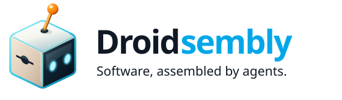
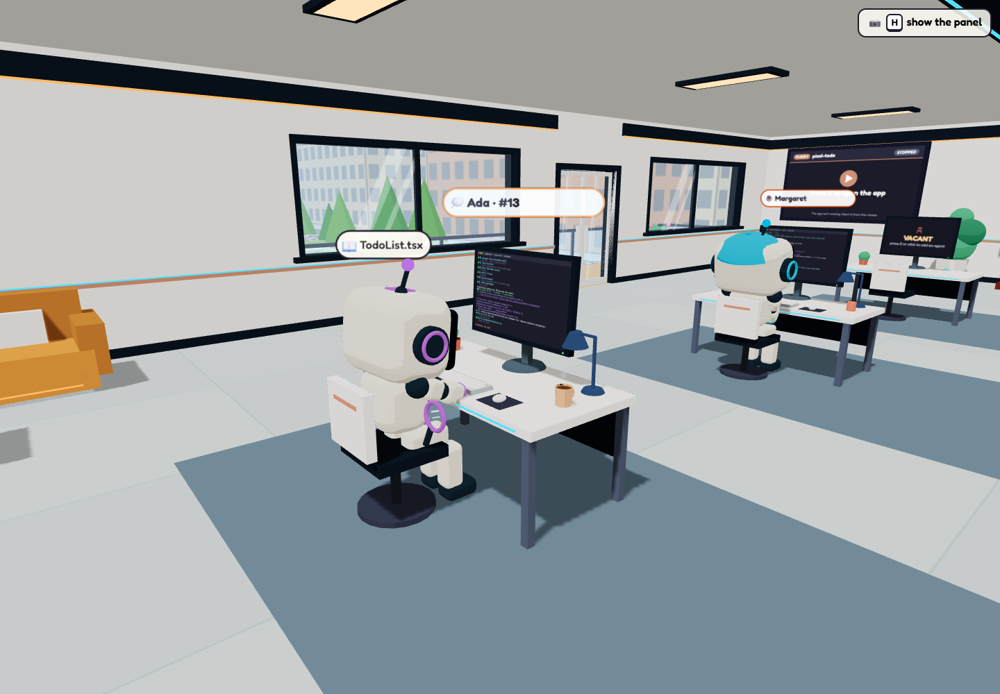
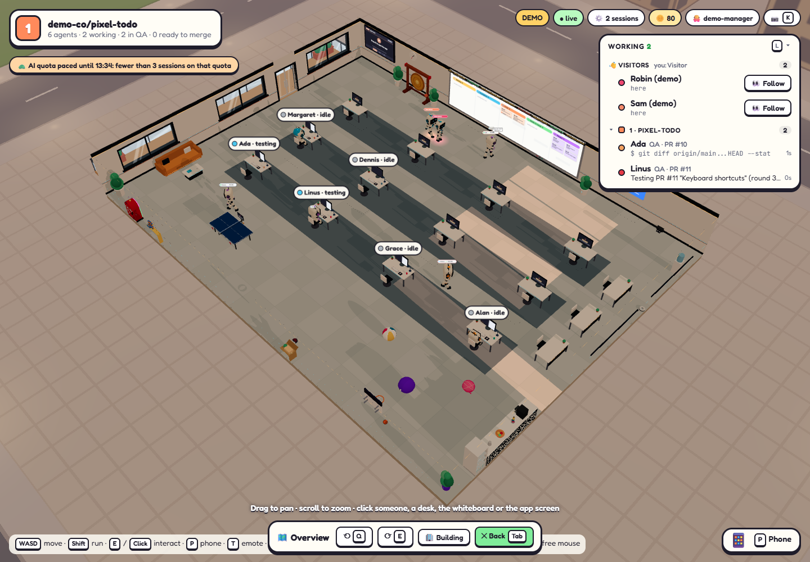
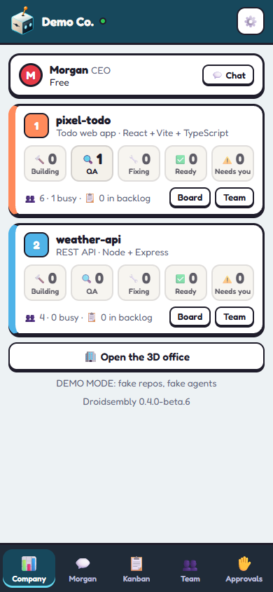

# Droidsembly

<p align="center">
  
</p>

**Small droids. Serious software.**

A visual workspace for AI-assisted software development: connect your GitHub repositories, coordinate coding agents and follow their work in an interactive 3D office or a mobile-friendly dashboard.

**English** · [Italiano](https://github.com/rosariomoscato/droidsembly/blob/main/README.it.md)

[Website](https://droidsembly.com) · [npm](https://www.npmjs.com/package/droidsembly) · [Releases](https://github.com/rosariomoscato/droidsembly/releases) · [Report an issue](https://github.com/rosariomoscato/droidsembly/issues) · [Contributing](CONTRIBUTING.md) · [Documentation](#documentation) · [Support the project](#support-the-project)

**Public beta release: 0.5.0-beta.1.** The release target is npm `latest`, so testers can run `npx droidsembly` without choosing a channel. Check [npm](https://www.npmjs.com/package/droidsembly) and the [release](https://github.com/rosariomoscato/droidsembly/releases/tag/droidsembly-v0.5.0-beta.1) for publication status. Includes manual cloud review/deployment profiles and cloud sign-in notifications, alongside CEO-guided app planning and interrupted-issue recovery. See [release notes and validation limits](https://github.com/rosariomoscato/droidsembly/blob/main/docs/RELEASE_NOTES_0.5.0-beta.1.md). Visit [droidsembly.com](https://droidsembly.com) for an introduction.

**Free and open source, under the MIT license.** No paid activation or commercial agent unlocks. Voluntary support helps development; your AI subscriptions, API usage and optional cloud services have their own costs and limits.

## Who it is for

- **Solo developers:** coordinate multiple agents on code and checks while staying in control of decisions.
- **Small development teams:** follow tasks, reviews and project progress in a shared workspace.
- **Makers and open-source maintainers:** experiment with prototypes and organize work across repositories.

You set the goals and supervise the work. The agents help you get it done.

## See the office



<details>
<summary>Office overview and mobile Pocket view</summary>





</details>

Actual captures of the published **0.4.0-beta.6**, taken on 21 November 2026 in an isolated no-AI demo with synthetic projects and activity. The close-up uses the built-in photo camera; Pocket is shown at a mobile viewport size. [Capture details](https://github.com/rosariomoscato/droidsembly/blob/main/docs/branding/screenshots/beta6/README.md).

## What you can do

- **Plan a new app with the CEO:** project-specific interview → editable plan covering scope, stack, environments and data → explicit **Approve plan and create issues** → dependency-linked GitHub tasks. No plan issues or worker/Box preparation before approval and confirmed publication. [Starter guide and recovery limits](docs/app-starter.md).
- **Coordinate coding agents:** Claude Code, Codex and OpenCode V2, with model selection and supported reasoning variants. Provider availability depends on the runtime; the Agent SDK runtime is Claude-only. OpenCode supports local terminals and Upstash Box workers; the office and CEO remain local. See [Box validation limits](https://github.com/rosariomoscato/droidsembly/blob/dev/docs/OPENCODE_BOX_VALIDATION.md).
- **Follow the full workflow:** issue → development and initial checks → pull request → separate QA session → corrections → merge when the configured conditions pass.
- **Keep control:** manual or automatic assignment, optional CEO onboarding, team-change approvals and a separate auto-merge switch.
- **Give cloud workers a manual profile:** application review (features, drift, security and SEO/GEO) or Vercel deployment with preflight and exact-plan approval. Production and resource/cost approvals are separate. These are workflow gates, not a CLI sandbox. [Profiles and limits](https://github.com/rosariomoscato/droidsembly/blob/main/docs/CLOUD_WORKER_PROFILES.md).
- **Watch real work:** live terminals, project floors, a Kanban board and the manager console. Local clones and worktrees separate agents' working copies; they are not security sandboxes.
- **Inspect AI usage:** multi-provider observations, reported tokens/costs and selective scheduling limits. Missing provider data remains unavailable, not zero or unlimited. See [AI usage](https://github.com/rosariomoscato/droidsembly/blob/main/docs/AI_USAGE.md) (Italian).
- **Ask for read-only analysis:** start a discussion without an issue or PR. Read-only rules are agent instructions, not a sandbox.
- **Use desktop or mobile:** a 3D office and a touch-friendly Pocket view, English/Italian interface, keyboard controls and accessibility settings. See [language coverage](https://github.com/rosariomoscato/droidsembly/blob/main/docs/languages.md).
- **Make the office yours:** robot agents, a robot dog, decorations, adaptive music, photo mode and time-lapse.

## Install this fork

**Package:** [droidsembly on npm](https://www.npmjs.com/package/droidsembly). After the 0.5 release is published, run `npx droidsembly` (`npx.cmd droidsembly` in PowerShell), or pin it with `npx droidsembly@0.5.0-beta.1`. Building a checkout uses that checkout's version, not necessarily the published bytes. These are launch instructions, not an automatic update of an existing office: first follow the [controlled update guidance](docs/QUICKSTART_PC.md). There is no desktop installer yet. `npx cubefarm` installs the original package, not Droidsembly.

**This is a beta, not a stable release, even on `latest`.** The maintainer selected `latest` for this public test release; 0.5.0-beta.1 checks that channel for updates. Earlier 0.4 betas continue checking `next`; its alignment is verified separately after publication. The package exposes no global `cubefarm` alias. The internal entry file `bin/cubefarm.js` and existing checkout launchers remain compatible. Existing legacy homes are adopted; `DROIDSEMBLY_HOME` takes precedence over `SWARM_HOME`, and ambiguous dual homes require an explicit choice. For side-by-side use, select a separate home and free ports as described below.

### Requirements

- [Node.js](https://nodejs.org/) **22 or newer**, with npm, and [Git](https://git-scm.com/).
- For real work: [GitHub CLI](https://cli.github.com/), authenticated with `gh auth login`, and a supported coding agent signed in to its provider.
- Claude Code is bundled through the Agent SDK. OpenCode **2.x** and Codex are installed separately when selected. OpenCode-only terminal sessions do not require a Claude subscription.
- Google Chrome for agents that test projects in a browser.

**Recommended office browser:** up-to-date Google Chrome is our reference browser for the isolated desktop checks. Other modern browsers may work, but were not validated in this test cycle; this is not a Chrome-only support policy. Native notification clicks and window focus remain unverified. See [release validation scope and limits](https://github.com/rosariomoscato/droidsembly/blob/main/docs/RELEASE_NOTES_0.5.0-beta.1.md).

The project targets Windows, macOS and Linux. The no-AI demo below does not require provider credentials or a GitHub login.

### 1. Download and build

Run these commands in the parent folder where you want a **new** checkout.

**Windows — PowerShell**

```powershell
git clone https://github.com/rosariomoscato/droidsembly.git
cd droidsembly
npm.cmd ci
npm.cmd run build
```

**macOS / Linux**

```bash
git clone https://github.com/rosariomoscato/droidsembly.git
cd droidsembly
npm ci
npm run build
```

### 2. Try the no-AI demo

From the checkout, start the built server with a dedicated data folder and ports:

**Windows — PowerShell**

```powershell
$env:SWARM_HOME = Join-Path $env:LOCALAPPDATA 'Droidsembly-Demo'
$env:SWARM_PORT = '4419'
$env:SWARM_HOST = '127.0.0.1'
$env:SWARM_PREVIEW_PORT = '9600'
$env:SWARM_DEMO = '1'
node dist-server/index.js --demo
```

**macOS / Linux**

```bash
SWARM_HOME="$HOME/.droidsembly-demo" SWARM_PORT=4419 SWARM_HOST=127.0.0.1 SWARM_PREVIEW_PORT=9600 SWARM_DEMO=1 node dist-server/index.js --demo
```

Open **http://127.0.0.1:4419/** and confirm **DEMO MODE** is displayed. GitHub and agents are simulated; demo state is saved only in the chosen demo folder. Stop with `Ctrl+C`. Choose unused ports if these are occupied.

### 3. Start a real office

Stop the demo first. Use a separate data folder and remove `--demo`. Real sessions can modify connected projects and consume AI quota.

**Windows — PowerShell**

```powershell
$env:SWARM_HOME = Join-Path $env:LOCALAPPDATA 'Droidsembly'
$env:SWARM_PORT = '4419'
$env:SWARM_HOST = '127.0.0.1'
$env:SWARM_PREVIEW_PORT = '9600'
$env:SWARM_DEMO = '0'
node dist-server/index.js
```

**macOS / Linux**

```bash
SWARM_HOME="$HOME/.droidsembly" SWARM_PORT=4419 SWARM_HOST=127.0.0.1 SWARM_PREVIEW_PORT=9600 SWARM_DEMO=0 node dist-server/index.js
```

Open **http://127.0.0.1:4419/**. These example folders are an explicit choice for a new installation, not a migration: existing data paths and launchers remain valid. `DROIDSEMBLY_HOME` is the canonical alias for `SWARM_HOME`. With neither set, existing `~/.cubefarm` data stays in place; new offices use `~/.droidsembly`. If both default folders exist, startup requires an explicit choice, without merging/moving data. Canonical `DROIDSEMBLY_*` settings take precedence over the legacy equivalents. See [environment/home compatibility and rollback](docs/ENV_HOME_MIGRATION.md).

New offices propose **OpenCode** for terminal workers and the CEO, without imposing a provider or model; existing office choices are preserved. Check both defaults before connecting a project. The Agent SDK runtime remains Claude-only. To skip the initial AI analysis, turn off **Let the CEO study this repository and plan from the brief**. Auto-assignment, auto-merge and periodic CEO reviews are separate settings. See [Agents](docs/agents.md) for provider setup and runtime limitations.

### 4. Start a new app with the CEO

In the manager console → **Plans and repositories**, choose **Something new**, select repository visibility and describe the app. Creating the project creates a GitHub repository; with the CEO enabled, it also starts an interview that consumes AI quota. **Open interview** opens the project's conversation in the phone.

Answer the questions, review and revise the complete plan, then use **Approve plan and create issues** only when ready. A “yes” in chat does not publish tasks. Approval applies to that exact project, revision and task set; the publication ledger records confirmed issues and their dependencies. Keep automatic assignment and automatic merge off if you only want to plan. [Full guide](docs/app-starter.md).

## Desktop, mobile and PWA

The Node.js backend runs on your computer; the browser displays and controls the office. Installing the PWA adds the interface to your home screen **but does not install the Node.js backend or coding agents**. The office computer must remain running and reachable.

For mobile installation and private remote access, follow [Pocket mode](https://github.com/rosariomoscato/droidsembly/blob/main/docs/pocket.md) and [Phone access](https://github.com/rosariomoscato/droidsembly/blob/main/docs/phone-access.md). PWA features require a supported browser and a secure context, such as HTTPS or localhost. The office has no built-in sign-in: keep it on loopback or use authenticated private access rather than exposing it publicly.

### Essential controls

| Control | Action |
| --- | --- |
| `W A S D` / arrows | Walk |
| `Shift` | Run |
| `E` / left click | Interact |
| `P` | Open the phone |
| `Tab` | Office overview |
| `K` | Photo mode |
| `M` | Mute |
| `H` | Help and full control list |
| `Esc` | Release the mouse / close a panel |

Settings include captions, motion comfort, UI scaling, contrast and list views. Pocket provides touch-friendly navigation.

## Updating

For a source installation, stop the office when agents are idle, back up your chosen `SWARM_HOME`, and review the [fork changelog](https://github.com/rosariomoscato/droidsembly/blob/main/docs/FORK_CHANGELOG.md). In a clean checkout on `main`, use `git pull --ff-only`, then `npm.cmd ci` and `npm.cmd run build` on Windows (`npm ci` and `npm run build` on macOS/Linux). Restart using the same data folder and ports. Preserve local changes before updating.

Do not use `npx cubefarm@latest` to update this fork: it targets the original npm package. This prepared CLI checks only `droidsembly`, using `next` for prereleases and `latest` for stable versions; an unavailable registry entry is ignored. The direct server commands above do not use the checkout's self-updating launcher; see [how updating works](https://github.com/rosariomoscato/droidsembly/blob/main/docs/how-it-works.md#updating-the-office) for that separate workflow. Package updates are manual; installing a new package name does not migrate an existing installation or its data.

## Support the project

Droidsembly is free and open source. If it helps you, you can support its development by starring the repository, sharing it, reporting reproducible issues or contributing improvements.

**You can support development voluntarily through [GitHub Sponsors](https://github.com/sponsors/rosariomoscato).** No donation is required to use the app or unlock agents. Technical limits and AI-provider quotas still apply.

## Documentation

- [Agents and provider setup](https://github.com/rosariomoscato/droidsembly/blob/main/docs/agents.md)
- [Workflow, terminals, QA and updates](https://github.com/rosariomoscato/droidsembly/blob/main/docs/how-it-works.md)
- [Multi-provider AI usage](https://github.com/rosariomoscato/droidsembly/blob/main/docs/AI_USAGE.md) (Italian)
- [Pocket, PWA and notifications](https://github.com/rosariomoscato/droidsembly/blob/main/docs/pocket.md) · [Phone access](https://github.com/rosariomoscato/droidsembly/blob/main/docs/phone-access.md)
- [Optional cloud agents](https://github.com/rosariomoscato/droidsembly/blob/main/docs/cloud.md) · [Voice](https://github.com/rosariomoscato/droidsembly/blob/main/docs/voice.md)
- [English/Italian coverage](https://github.com/rosariomoscato/droidsembly/blob/main/docs/languages.md)
- [Contributing and development](https://github.com/rosariomoscato/droidsembly/blob/main/CONTRIBUTING.md)
- [Fork changelog](https://github.com/rosariomoscato/droidsembly/blob/main/docs/FORK_CHANGELOG.md) (Italian)
- [Local validation report](https://github.com/rosariomoscato/droidsembly/blob/main/docs/validation-english-italian.md) · [Pathfinding investigation](https://github.com/rosariomoscato/droidsembly/blob/main/docs/pathfinding-investigation.md)

CI results and historical local test failures are separate evidence; a green CI run does not establish that those local failures have been resolved.

## Credits and license

Droidsembly is maintained by [Rosario Moscato](https://github.com/rosariomoscato), based on [CubeFarm by Leon van Zyl](https://github.com/leonvanzyl/cubefarm). This fork was previously hosted at `rosariomoscato/cubefarm`.

The fork adds OpenCode V2 integration, model/variant selection, optional onboarding and manual analysis, English/Italian support, robot visuals and branding, coordinated desktop/mobile styling, adaptive music and multi-provider usage monitoring. The [changelog](https://github.com/rosariomoscato/droidsembly/blob/main/docs/FORK_CHANGELOG.md) records implementation and validation history.

Licensed under [MIT](https://github.com/rosariomoscato/droidsembly/blob/main/LICENSE), preserving the original **Copyright (c) 2026 Leon van Zyl** notice. Third-party components retain their respective licenses, including the [Sora font's SIL Open Font License](https://github.com/rosariomoscato/droidsembly/blob/main/client/public/icons/Sora-OFL.txt).
