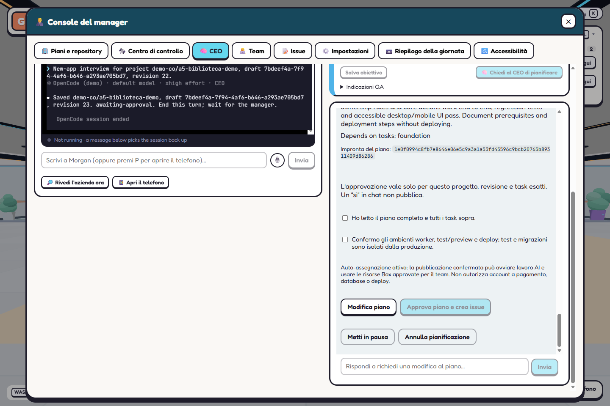

# CEO app-starter: real isolated validation — 2026-11-20

## Scope and outcome

The maintainer authorized a real, isolated test using a disposable private GitHub
repository, synthetic tasks and existing local OpenCode authentication. The
tested application was an Italian task list using React/TypeScript/Vite and
browser localStorage; no database, cloud Box or deployment was provisioned.

The office ran from a locally built and installed package, through its compiled
server, bound to `127.0.0.1:4437`, with a dedicated home, projects directory and
preview range. Automatic assignment, automatic merge, periodic CEO review and
office updates remained disabled. No live-office installation or state was used.

Observed with the real browser, office API and GitHub:

- Private repository creation and project-specific CEO interview.
- Persisted questions, answers and decisions; revision-bound plan editing.
- Explicit approval of revision 7 and its exact fingerprint.
- Publication of three approved tasks with dependencies: foundation, interface
  depending on foundation, verification depending on both preceding tasks.
- A local OpenCode worker manually assigned only the foundation task.
- A development PR and fresh-session QA covering tests, build, persistence,
  malformed storage and mobile display.
- After the fixes below, exactly one explicit QA rerun reached `passed`; its
  worker reached `done` and stayed there for 130 seconds, spanning two watchdog
  ticks, without a duplicate session.
- The maintainer separately authorized merging that disposable PR. GitHub
  confirmed the merge and closure of its foundation issue.

The remaining interface and verification tasks were deliberately not executed:
finishing a disposable app was unnecessary to validate the starter workflow.
This is not a claim of complete application delivery or cross-provider coverage.

## Defects found and corrected

### OpenCode default-model response

OpenCode 2.3.2 returned a location-scoped `{ location, data }` result from
`ctx.model.default()`. Reading it as a bare model submitted an undefined model ID;
the intended CEO turn did not finish normally.

`14fdea2` unwraps that result while retaining the bare-response path. Two new
regressions cover a wrapped model and a wrapped null default. The real interview
then completed its office turns normally.

The automatically chosen free model separately returned a quota error. This was
not a model-envelope defect. The maintainer explicitly chose
`openai/gpt-6.1-terra` for the CEO and worker; no credentials were copied.

### Duplicate QA during report publication

The tester was marked `done` before awaiting evidence/report publication. The
watchdog could then consider a still-`testing` QA record orphaned and requeue it.

`5ea2bb4` retains task ownership through publication and final QA disposition,
without overwriting a manager stop. Four regression cases cover pass, fail,
comment-publication failure and stop during publication. Both pass/fail race
cases failed before the ordering fix. The real rerun described above passed.

## Validation and remaining limits

- Seven targeted files: **77 tests passed**, including the two fixes and the
  app-starter workflow. Repeated after creating the fix commits: **77 passed**.
- Typecheck and ordinary production build: **passed**.
- Installed local package: **104 built artifacts byte-compared** before the
  real QA rerun. Package version remained beta.5; this was not a release.
- Full serial suite including both fixes: **3587 passed, 1 failed** across
  **320 passed files, 1 failed file**. The failure was a 15-second timeout in
  `server/resumeReviewRegression.test.ts`, renamed legacy worktree recovery.
- All **11 tests** in that file passed on an isolated serial rerun. The exact
  failing case then passed three times at **11.431, 11.133 and 12.688 seconds**
  with Git Trace2 enabled and unchanged deadlines/assertions.
- Traces show 25 top-level Git commands per case, plus nested Git processes.
  Fixture setup and preservation snapshots consumed most elapsed time; recovery
  itself took about 1.8 seconds in the slowest observed passing run.
- These results suggest limited timing headroom but do **not** prove the cause
  of the original timeout or turn the full-suite result into a pass.
- A new full serial run for integration preparation was started after these
  commits. Its result must be recorded separately; it is not presumed green.

Earlier full-suite/install/smoke negatives are preserved in
[the A5 validation history](A5_LOCAL_VALIDATION_20261120.md). This real test does
not erase them. The existing beta.6 candidate PR #86 has its own prior Windows
CI failure; this report does not certify that candidate or authorize publishing.

No real database, migration, deployment, Box, Claude/Codex interview or full
accessibility audit was tested. Screenshot/browser observations are not evidence
of production data isolation or provider availability.

## Cleanup and integration boundaries

At the maintainer's request, the dedicated local installation, state, projects,
workspaces, artifacts and test helpers were deleted after stopping only their
verified server and PTY process trees. A local report and artifact-hash records
were retained outside the source checkout.

GitHub repository deletion was attempted but refused with HTTP 403 because the
current authentication lacks `delete_repo`. The remote disposable repository
therefore remained at the last verification; authentication scopes were not
changed. Do not claim complete remote cleanup.

Source work is proposed through the feature branch to `dev`, then a separate
reviewed release promotion from `dev` to `main`. No tag, npm publish, Release
workflow, automatic merge or live-office update is part of these validation
results. The pre-existing local `CLAUDE.md` edit is excluded from this integration.

## Integration CI — executed failure retained

[CI 44812334632](https://github.com/rosariomoscato/droidsembly/actions/runs/44812334632)
ran once by manual dispatch on `f305fc8`, without retry:

- Ubuntu, macOS Intel, native macOS ARM64 and Windows Node 22 passed installation,
  typecheck, the full suite, build and installed-package smoke.
- Windows Node 24 passed installation/typecheck but failed its full suite:
  **3587 tests passed, 1 failed**; **320 files passed, 1 failed**.
  Build and package smoke were not executed in that job.
- The failure is the protected synthetic PowerShell launcher scenario at
  `scripts/opencodeGateLauncher.test.ts:131`: `ETIMEDOUT` against its unchanged
  4000 ms command budget. This is not the earlier local worktree-recovery timeout.

The retained safe artifact adds evidence for this execution: both startup
checkpoints were present, first stderr was observed at 3725 ms, and the script
reported milestones through `process-info-ready` at script-clock 114 ms.
The owner timer fired at 4010 ms (10 ms delay); process-tree stop was requested,
taskkill succeeded, and exit/close were observed at 4114 ms. Disposal and
failure-visibility milestones were not reached, so their assertions are not
certified. This is consistent with little command budget remaining after slow
startup, but does not establish the OS/runtime cause or explain earlier
executions that produced no checkpoints.

No timeout, assertion, workload or concurrency was relaxed; no unchanged CI retry
was launched. This new failure blocks integration/release readiness. Passing
platforms, the real CEO workflow and targeted regressions do not cancel it.
The separate local full serial run was still pending at this CI checkpoint.

## Final local integration run

The full serial run started at source `5ea2bb4` completed after the documentation
follow-ups, with implementation/tests/config unchanged:
**3587 tests passed, 1 failed; 320 files passed, 1 failed**, in 1115.35 seconds.

The failure was `server/notifier.test.ts:105`, the client-source secret-boundary
scan, at the unchanged 5000 ms test deadline (reported duration 5024 ms).
The scan's elapsed-time, file-count and no-violation assertions did not complete.
This is neither evidence of a secret leak nor certification that the boundary
scan passed. It is distinct from both the earlier local worktree timeout and the
new Windows Node 24 CI PowerShell failure. No further full-suite retry was started.

Integration validation remains **NON-PASS** locally and in CI. The feature branch
and evidence are pushed; no integration PR, merge, release tag, publication or
live-office update has been performed. Resolving or separately assessing the
Windows timing failures is required before advancing release readiness.

## Authorized Windows startup-contract change

The maintainer explicitly approved separating interpreter startup from functional
execution after reviewing the failures. This is a **test-contract change**, not a
demonstrated fix for the historical Windows startup cause:

- The PowerShell fixture now has a **10-second startup budget**, ending only at
  the exact complete stderr line `probe script-enter ms=0`.
- The original **4-second functional budget** then covers the launcher work,
  protected synthetic input handling, child execution, disposal, acknowledgement
  and stream close. All existing functional assertions remain.
- The enclosing test uses **25 seconds** to accommodate the two bounded phases,
  existing process-tree termination/drain bounds, and fixture setup.
- The shared process helper keeps its original deadline semantics for every
  caller that does not opt into the startup contract. Readiness is accepted only
  once; arbitrary output, repeated markers and delayed timer callbacks cannot
  extend either phase. Missing/late readiness and early exit without readiness
  fail closed. Existing process-tree cleanup remains in force.
- Seven new deterministic regressions exercise the startup contract.
  **85 tests in seven targeted files passed**, followed by **4 real-process
  lifecycle tests passed**. Typecheck and diff checks passed.
- The client-source secret-boundary scan and its **5-second** limit are unchanged.
  Its isolated pass does not resolve the previous full-run timeout.

New full-suite/CI executions on this changed test contract must be assessed
separately. Neither this change nor its targeted passes erase earlier failures,
certify the existing beta.6 candidate, or authorize merging/publishing.

## Final changed-contract validation — PASS

On `36e0848`, the first CI execution of the changed startup contract,
[44815997683](https://github.com/rosariomoscato/droidsembly/actions/runs/44815997683),
passed **all five environments**: Ubuntu, Windows Node 24, Windows Node 22,
macOS Intel and native macOS ARM64. Each completed clean installation,
typecheck, full tests, production build and installed-package smoke.

The ordinary local `npm test` then completed with **3595/3595 tests passed in
321/321 files**, in 604.49 seconds. Typecheck and ordinary production build also
passed on this implementation. The unchanged client-source scan completed its
assertions in this full run.

These are new positive results on the revised contract, not retroactive passes
for any previous failure or proof of its historical cause. Later evidence-only
commits do not change runtime/test/configuration/package bytes. Feature
integration is proposed against `dev`; its PR checks, release candidate #86,
promotion and publication remain separate gates.

### Retained demo screenshots

The following synthetic demo captures are from the earlier `c138d62` checkpoint,
not new screenshots of `36e0848`. They illustrate desktop/mobile approval
controls, not the final interview-history layout or real-provider behavior.
Their original test context is documented in the A5 validation history.

