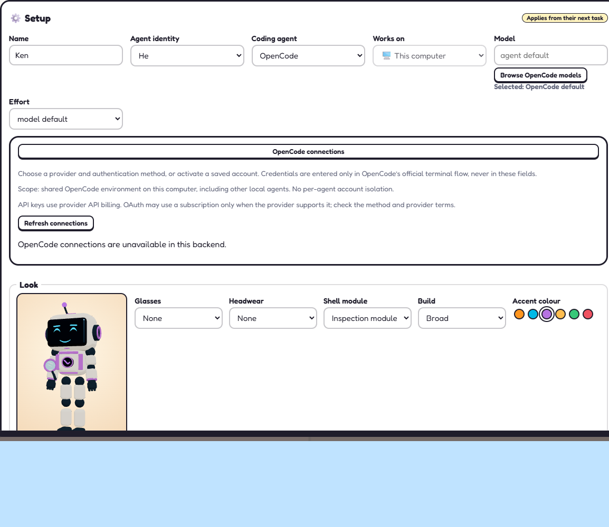

# OpenCode V2 in Upstash Box: validation and limits

## Italiano

### Perimetro

I worker OpenCode V2 usano il normale adattatore terminale Box: installazione privata della CLI, tmux, `--standalone` e plugin V2 con eventi JSONL. Non viene usato `box.agent.run()`. Ufficio e CEO restano locali; il CEO supporta Claude Code oppure OpenCode. Codex CEO, release, deploy e aggiornamenti dell'installazione reale non fanno parte di questa modifica.

La CLI della Box è fissata a **2.2.6** e verificata anche quando esiste il marker di setup. Il profilo installa solo il coding agent selezionato, aggiungendo Playwright soltanto se è richiesto il browser. Non viene aggiornata la CLI sul PC e un errore cloud non avvia un worker locale alternativo.

### Connessioni e file

- Il login si svolge nel terminale ufficiale OpenCode della Box, con directory XDG proprie. Non vengono copiati login, token OAuth, database o configurazioni OpenCode dal PC.
- Setup dell'agente mostra provider, metodi e account attraverso una proiezione dei soli metadati. Le modifiche richiedono conferma dell'ambito, assenza di lavoro/terminali attivi e identità dell'host invariata. Le credenziali si inseriscono nel terminale ufficiale, non nei campi dell'app.
- I metadati usati dal selettore non certificano quale account sia attivo, validità delle credenziali, quota o fatturazione. Le credenziali d'ambiente non sono modificabili da questo selettore. Il completamento di una configurazione non rilascia automaticamente task trattenuti.
- Le query attendono l'attivazione attraverso le liste provider/integrazioni di V2; un errore di query è distinto da una connessione non autenticata. Nessun retry, warmup o fallback di account/provider.
- I file della sessione OpenCode vengono scritti dal processo shell della Box, **non tramite `SDK files.write`**. Il writer è limitato alla sessione UUID e ai nomi previsti, usa chunk UTF-8/base64 limitati, creazione esclusiva, no-follow e verifica owner/offset. Se fallisce, non parte la PTY. Nessun `chmod/chown`, reset dell'indice o fallback al vecchio upload.
- GitHub mantiene la configurazione cloud esistente. Le prove isolate usano esclusivamente un PAT dedicato al repository sintetico; non recuperano il token GitHub del PC.

Il plugin inoltra risposte finali, errori, interruzioni, nomi dei tool e segnali di utilizzo disponibili. Non esporta argomenti o risultati dei tool come telemetria. Un costo nullo o assente non dimostra gratuità. L'agente esegue codice con le credenziali disponibili nella propria Box: **workflow, permission rule e guardrail non sono un sandbox OS**.

### Correzioni dello scheduler

L'admission policy viene verificata prima di assegnare QA/fix automatici e prima di preparare un checkout. Ulteriori guardie proteggono l'ingresso diretto a quei percorsi. Una PR storica rimane visibile e conservata, ma non può occupare un worker quando il backend vieta quel lavoro. Questo controllo è distinto da `autoAssign` e `autoMerge`.

Il gate controlla inoltre che il worker sia libero prima del login e della verifica post-login: un task in preparazione è `auth-worker-not-idle`, non un errore OAuth dedotto dal solo exit code del login.

### Prova end-to-end completata

Il **9 novembre 2026** è stato completato un gate reale autorizzato su un repository sintetico privato:

| Controllo | Esito |
| --- | --- |
| Versioni | CEO locale 2.2.5, worker Box 2.2.6, SDK Upstash 0.7.9 |
| Autenticazione/modello | OAuth ufficiale, `openai/gpt-6.1-sol#medium` |
| AI | Un CEO locale e un worker remoto, un turno per ruolo; niente QA o fallback aggiuntivi |
| Consegna | Nuova issue, commit/push e PR OPEN verificata, senza merge |
| Test | Worker exit 0; **11/11 controlli indipendenti**, senza fail/cancelled/skipped/todo |
| Worktree | Quattro checkpoint puliti sul branch approvato e allo stesso SHA della PR |
| Git | Staging canonico una sola volta, exit 0, UID effettivo del processo Git 1002 verificato; indice 1002:1002/0644 leggibile e scrivibile prima/dopo |
| Diagnostica | Osservatori Git/SDK completi, nessun drop; unico errore SDK il 404 atteso dopo l'eliminazione |
| Teardown | Box eliminata, assenza API verificata e watchdog concluso |

Il candidato precedente al consolidamento era identificato dal fingerprint sorgenti `719397994b459815bf257ec4f660834b8bb50312852ae090effe7a7fac9c8a7e`; aveva **402/402 test locali su 25 file**, typecheck e build superati. Le prove complete, i fallimenti precedenti e gli hash sono conservati privatamente fuori dal checkout. Non pubblicare credenziali, transcript, stato completo o identificativi del repository privato come allegati della PR dell'app.

Il PASS riguarda quel percorso **strumentato**, non ogni workload o provider. Non identifica con certezza l'attore interno Upstash dei precedenti cambi a root/0600. Il confronto con l'esperienza ordinaria senza osservatore esterno, il rilascio e l'aggiornamento PC restano verifiche/decisioni successive. Non certifica sopravvivenza a pausa/ripartenza della Box e non risolve automaticamente problemi storici fuori perimetro.

### Strumenti opt-in, separati dal runtime ordinario

`server/openCodeGate*.ts`, `shared/opencodeGate*.ts` e gli script `opencodeBoxGate*` implementano il controller di accettazione e la sua diagnostica. Non sono avviati dall'ufficio ordinario. Il writer dell'acceptance indipendente è separato da quello dei file di sessione usato dall'app.

Il gate usa il vero `Swarm` con stato fresco e credenziali volatili. Richiede repository privato/nome/base corretti, versioni e inventari, worker libero, approvazione risorse e **successiva approvazione AI distinta**. Mantiene un CEO e un worker, una Box, una issue nuova, istruzioni e comandi finiti; vieta follow-up, QA, merge e deploy. I normali worker non ricevono automaticamente queste permission rule sintetiche.

I report conservano prima fase fallita/categoria chiusa, snapshot dell'indice, scope PR, SHA, branch, pulizia e risultati dei test anche al fallimento. Gli errori sconosciuti rimangono `unknown`; nessuna causa viene inventata. Le verifiche della PR e dei test non vengono ridotte per ottenere un PASS.

Per la sola verifica locale preparare fuori dal checkout un piano di metadati: `runId`, `repository`, `model`, `localVersion`, `remoteVersion`, `homeDirectory` fresca sotto la directory temporanea `opencode`, `manifestFile` e `manifestSha256`. Il manifest contiene `sources: [{file, sha256}]`; il fingerprint è lo SHA-256 della lista JSON `[file, sha256]` ordinata con `localeCompare`.

```powershell
node --import ./node_modules/tsx/dist/loader.mjs ./scripts/opencodeBoxGate.ts --plan <piano-esterno.json> --check
```

`--check` non crea la home, non importa il backend live e non esegue CLI provider, login, AI o chiamate cloud. Non avviare il launcher protetto per questa sola verifica. L'esecuzione reale richiede nuova autorizzazione, `--execute-approved`, console visibile, inserimento manuale protetto e le frasi complete del nuovo run. Nessuna approvazione o piano consumato autorizza un'altra Box.

Deadline operativa originale: 25 minuti inclusa autenticazione, più 5 per teardown; login limitato a 10 minuti. Un watchdog separato viene armato dopo l'ID della Box. Una terminazione prima dell'ID può lasciare una creazione ambigua: non dichiarare assenza senza verifica. Budget indicativo 0,50 USD **non è un hard cap del provider**. Costi fatturati e quota restano da verificare sull'account. Cleanup non confermato rende negativo il risultato, anche se il lavoro è riuscito.

Gli harness esterni della prova conservata usano entry ESM e import ordinati, oltre a un osservatore del processo Git. Non fanno parte dell'installazione dell'app. I test nel repository usano adattatori finti, nessuna AI e nessuna risorsa reale; non sono una nuova certificazione cloud.

### Interfaccia in demo isolata

Setup OpenCode, selettore modelli e pannello connessioni sono stati aperti in un ufficio demo con stato e porta dedicati. Il backend demo non offre connessioni provider: il pannello mostra l'indisponibilità senza ricorrere a credenziali/CLI reali. Questo screenshot documenta soltanto layout, ambito e stato di errore, non un login riuscito.



## English

OpenCode V2 workers now use the existing Box terminal/tmux adapter with pinned CLI 2.2.6, Box-owned XDG/auth state and metadata-only connection/model discovery. The office and CEO stay local. Provider credentials are entered only through OpenCode's official terminal flow; no PC OAuth/DB is copied into a Box. Session files are written by the shell process rather than SDK file upload. Automatic QA/fix admission is checked before any task or checkout mutation.

An explicitly authorized **instrumented** run completed on 2026-11-09: one local CEO and one cloud worker, official OAuth, commit/push and an open PR at the verified SHA, worker tests and **11/11 independent checks**, four clean/on-branch worktree snapshots, observed Git UID 1002 with a healthy index, complete diagnostics, and Box deletion with API absence verified. Full evidence and previous failures remain private outside the repository. The pre-consolidation candidate passed 402 local tests, typecheck and build.

This is not a certification of every provider/workload, uninstrumented daily operation, survival across Box pause/restart, billing, or the vendor's internal root cause. Workflow/controller permissions are not an OS sandbox. Ordinary-operation validation and release/PC updates remain separate next steps.

Acceptance scripts are opt-in and distinct from normal startup. `--check` validates metadata and source hashes locally without backend imports, credentials or resources. A real run requires a fresh plan, protected manual credentials and separate resource/AI approvals. A failed run stops without unchanged retries or relaxed assertions. Preserve the private repository; never merge, publish, deploy or update an installation as a side effect of this smoke test. A successful request to delete a Box is not proof of its absence.

References: [Upstash live sessions](https://upstash.com/docs/box/overall/live-sessions), [OpenCode V2 CLI providers](https://opencode.ai/v2/docs/cli/providers), [V2 plugins](https://opencode.ai/v2/docs/build/plugins/server).
